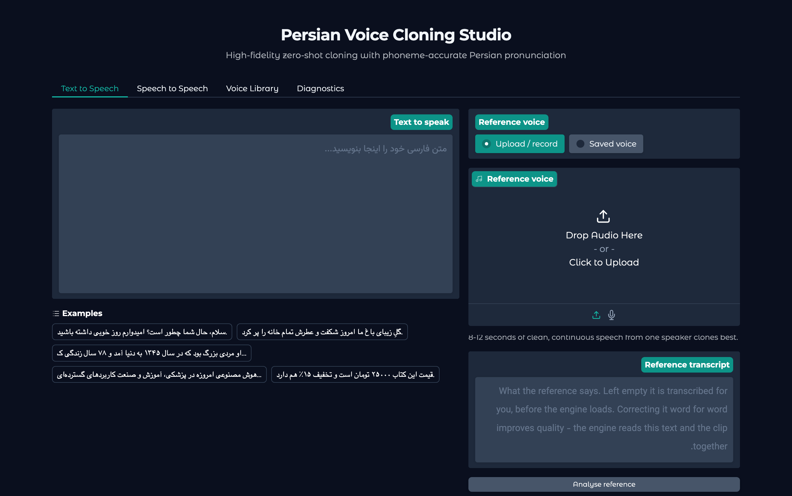
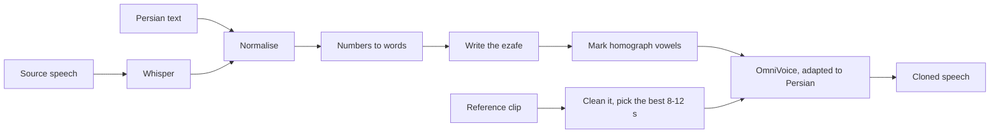

# Persian Voice Cloning Studio

Zero-shot voice cloning for Persian. Give it 8–12 seconds of someone's voice and
any Persian text, and it reads the text in that voice.

Persian script leaves out much of what a speech model needs to hear, so the text
goes through a Persian front-end first. The speech model,
[OmniVoice](https://github.com/k2-fsa/OmniVoice), was then trained further on
about 128 hours of Persian speech. A change went into the app only when it won an
evaluation whose rule was written down before any audio was generated.


*B.Sc. final project, July–November 2026. See
[How this project was built](#how-this-project-was-built).*



## Highlights

- **3 of 165 words mispronounced** by the final model in a blind listening test,
  against 16 for the first Persian adaptation. It was picked as the best reading
  in 8 of 12 sentences ([§23]).
- **No invented ezafe.** Trained on transcripts with the ezafe written in, the
  model stopped adding one where none belongs: 1 of 33 trap words, against 11
  ([§23]).
- **The voice is kept.** Over 25 speakers never used for training or for any
  decision, speaker similarity matches the first adaptation (+0.001, 95% CI
  [−0.006, +0.007]). The character error rate is the lowest of the versions
  tested: 3.81% against 4.61% ([§24]).
- **A complete application.**
  - a web interface in Persian and English, a command line and a Python API
  - a voice library and speech-to-speech
  - reference-audio cleanup
  - a memory guard that lets it run on a 16 GB Apple Silicon Mac
- **An evaluation built to be believed.** Held-out speaker similarity,
  pre-registered decision rules, sealed test sets, blind listening tests, and
  negative results reported as such.

## Why Persian is hard

Most TTS systems handle Persian badly, and the reason is in the script rather
than the sound. Persian script does not write down much of what a synthesiser
needs:

| Problem | Example | What a naive TTS does |
|---|---|---|
| Short vowels are unwritten | `کرم` = *kerm* (worm), *karam* (generosity), *krem* (cream) | guesses |
| Ezafe is invisible | `کتاب من` is pronounced *ketâb**e** man* | usually omits the /e/ |
| Homographs | `گل` = *gol* (flower) or *gel* (mud) | guesses |
| Arabic/Persian glyphs mix | `ي` vs `ی`, `ك` vs `ک` | out-of-vocabulary tokens |
| Numbers | `۱۴۰۳` | reads digits, or nothing |

The front-end fixes each of these before the model sees the text.

## How it works



### Text front-end

1. **Normalisation.** Arabic and Persian letterforms, digits, ZWNJ and
   punctuation are made consistent.
2. **Verbalisation.** Numbers, dates, times, currency and percentages become
   words.
3. **Chunking.** Long text is split at sentence boundaries, and the chunks are
   joined with equal-power crossfades.
4. **The ezafe is written in.** hazm's ParsBERT part-of-speech tagger decides
   where it goes, and it is written as `کتابِ`, `خانهٔ` or `دانشجوی`. The tagger
   was reworked to run without spaCy, in about 0.9 GB. Heard blind, this cut
   mispronounced words from 12 to 9 of 147 ([§15]).
5. **Homograph vowels.** For words such as `گل` (*gol* / *gel*), the first short
   vowel is written from [Homo-GE2PE](https://huggingface.co/MahtaFetrat/Homo-GE2PE-Persian)'s
   reading of the whole sentence. This halved the homographs heard wrong, from
   14 to 8 of 23 ([§17]).

### The model

- **Choosing a base.** About ten open models and variants were evaluated:
  F5-TTS, OmniVoice, MOSS-TTS (two versions), Fish S2 Pro, Higgs TTS 3,
  Chatterbox, Pocket-TTS Farsi, LongCat-AudioDiT and ParsVoice-XTTS. OmniVoice
  already has Persian among its 600+ languages. It had the highest held-out
  speaker similarity on the development set: 0.583, against 0.546 for the best
  F5-TTS configuration ([measurements]).
- **Adapting it to Persian.** OmniVoice was trained further with its official
  recipe on Kaggle GPUs ([docs/OMNIVOICE-ADAPTATION.md](docs/OMNIVOICE-ADAPTATION.md)).
  The data was 127.9 hours of Persian from Common Voice 26 and Neyshekar v6:
  87,499 clips from 3,835 speakers.
- **Writing the ezafe into the training data.** The model had learned from
  transcripts where the ezafe is never written, so it guessed one. The run was
  repeated with 102,062 ezafes written into 45,907 of 66,023 transcripts, about
  22.5 GPU-hours. The app reads with its export at step 5,000 ([§23], [§24]).

If OmniVoice is not installed, the app falls back to F5-TTS with a community
Persian checkpoint.

### The application

- **Interface.** A Gradio web interface in Persian (right to left) or English,
  with tabs for text to speech, speech to speech, the voice library and
  diagnostics. The command line and the Python API run the same pipeline.
- **Speech to speech, two ways:**
  - re-speak: speech recognition, then the text front-end, then synthesis
  - voice conversion with Seed-VC, which keeps the source's delivery
- **Reference processing:**
  - a 0–100 quality score
  - denoising and optional vocal isolation
  - silence trimming
  - automatic choice of the best 8–12 s window
  - loudness normalisation
- **Scoring.** Speaker similarity on every render, and held-out similarity when
  other clips of the speaker are given.
- **Memory guard for 16 GB machines.** One large model is in memory at a time,
  and the OmniVoice worker stops the moment macOS reports memory pressure.

## Results

Each row compares two versions that differ in one thing.

| Change | Measured on | Before | After | Details |
|---|---|---|---|---|
| Ezafe written into the training transcripts | words mispronounced, heard blind (of 165) | 16 | **3** | [§23] |
| | ezafe added on trap words (of 33) | 11 | **1** | [§23] |
| | character error rate, 25 unseen speakers | 4.61% | **3.81%** | [§24] |
| | held-out similarity, 25 unseen speakers | 0.6065 | 0.6072 (no detectable change) | [§24] |
| First Persian adaptation, against the published model | words mispronounced, heard blind (of 114) | 15 | **12** | [§19] |
| | character error rate on the same renders | 4.8% | **3.7%** | [§19] |
| | held-out similarity, sealed test of 27 unseen speakers | | +0.001 [−0.004, +0.007] | [§12] |
| Homograph vowels written in | homographs misread, heard blind (of 23) | 14 | **8** | [§17] |
| Ezafe written into the input text | words mispronounced, heard blind (of 147) | 12 | **9** | [§15] |
| OmniVoice instead of the best F5-TTS setup | held-out similarity, 9 speakers | 0.546 | **0.583** | [measurements] |
| F5-TTS trained further on 2,739 speakers | held-out similarity, 9 speakers | 0.520 | **0.539** | [F5 training] |

**Limits.**
- Each listening test had one listener (the author), one reference voice and one
  seed, so small differences there are indicative.
- The similarity results rest on 9 development speakers, and on 25 and 27 unseen
  ones.
- The character error rate is a recogniser's reading, not a listening test.
- None of this is a state-of-the-art claim: the similarity scale is local to
  this project's corpus.

## How it was evaluated

- **Held-out speaker similarity.** A render is compared against *other*
  recordings of the same speaker, never against the clip it was cloned from. The
  comparison uses an ECAPA-TDNN speaker encoder. Scoring against the prompt
  rewards copying its room and microphone, and runs about 0.26 high. On a
  verified nine-speaker corpus, different speakers score 0.132 and two
  recordings of the same speaker score 0.689.
- **CER, not WER.** Whisper large-v3-turbo transcribes each render. Persian
  compounds have no fixed spacing, so word error rate partly measures where the
  spaces fall: real human speech from the corpus scores 37.4% WER but 7.8% CER.
- **Paired statistics.** Versions are compared speaker by speaker, with 95%
  confidence intervals.
- **Rules written first.** Every check was registered in `eval/runs/*.json`,
  with its decision rule, before any audio was generated. Sealed test sets were
  scored once, for the final candidates, and never used to choose.
- **Blind listening.** Renders were played in random order, loudness matched
  and unlabelled, and mispronounced words were marked one by one.
- **Negative results are kept.** These all did nothing or made things worse,
  and are reported as such:
  - feeding IPA to a phoneme-capable model ([docs/MEASUREMENTS.md](docs/MEASUREMENTS.md))
  - a sukun before adverbs ([§17])
  - vowels written on every word ([§21])

## Quick start

**You need:**
- Python 3.10–3.12 (3.11 recommended)
- 16 GB of RAM
- about 15 GB of disk for libraries and models
- `ffmpeg`

An NVIDIA GPU makes it much faster but is not required; Apple Silicon works.

```bash
git clone https://github.com/Ahmadreza-Merikh/voice-cloning.git
cd voice-cloning
./scripts/setup_env.sh                 # creates .venv and installs the requirements
.venv/bin/pip install -e .             # adds the voiceclone command

# OmniVoice, the default engine, runs in an environment of its own
pip install uv
uv venv --python 3.11 ~/.cache/persian-voice-cloning/omnivoice/.venv
VIRTUAL_ENV=~/.cache/persian-voice-cloning/omnivoice/.venv uv pip install omnivoice==0.2.1

.venv/bin/python app.py                # then open http://127.0.0.1:7860
```

- **Weights.**
  - The Persian-adapted OmniVoice weights (about 2 GB) came out of a private
    Kaggle run and are not in this repository.
  - Without them the app reads with the published OmniVoice weights and says
    so.
  - `scripts/fetch_adapted_weights.py` downloads them for the account that
    trained them.
- **F5-TTS fallback.** `.venv/bin/python scripts/download_models.py` fetches
  F5-TTS (about 5.5 GB). The app uses it where OmniVoice is not installed.
- **Homograph vowels** come from a separate G2P project built on Homo-GE2PE.
  Point `VOICECLONE_G2P_REPO` at it. Without it the app still runs and reports
  this under Diagnostics.
- **Apple Silicon.** PyTorch's Metal backend has an intermittent
  `Bus error: 10`; `--device cpu` avoids it.
- **Checking your setup.** `.venv/bin/voiceclone doctor` reports what your
  machine can run.

## Usage

### Web interface

```bash
.venv/bin/python app.py --language en      # English interface; the default is Persian
.venv/bin/python app.py --port 8080 --share
```

For a good first run:
1. Give a clean 8–12 s reference clip.
2. Press **Analyse reference** to get its quality score and transcript.
3. Correct the transcript if it is wrong.
4. Type Persian text and generate.

### Command line

```bash
voiceclone tts "سلام، حال شما چطور است؟" -r reference.wav --reference-text "متن فایل مرجع" -o out.wav
voiceclone tts @story.txt -r reference.wav -o story.wav        # long text from a file
voiceclone s2s source.wav -r reference.wav -o out.wav           # re-speak it in another voice
voiceclone text "قیمت ۲۵۰۰۰ تومان است" -e omnivoice            # show what the front-end writes
voiceclone check reference.wav                                  # analyse a reference clip
voiceclone voices add "Narrator" -r reference.wav               # save a voice
```

`--mode seedvc` keeps the source's delivery in `s2s`; it needs
`./scripts/setup_env.sh --seedvc` first.

### Python API

```python
from voiceclone import Studio

studio = Studio()
result = studio.synthesize(
    "سلام، این یک آزمایش شبیه‌سازی صداست.",
    "reference.wav",
    reference_text="متن فایل مرجع",
    seed=42,
)
print(result.output_path)
print(result.report())
```

## Repository layout

| Path | Contents |
|---|---|
| `app.py` | starts the web interface |
| `src/voiceclone/text/` | the Persian front-end: normalisation, numbers, ezafe, homographs, chunking |
| `src/voiceclone/audio/` | reference analysis and cleanup |
| `src/voiceclone/engines/` | the speech engines and the recogniser; several run as workers in environments of their own |
| `src/voiceclone/evaluation/` | speaker similarity and CER scoring |
| `src/voiceclone/pipelines/`, `ui/`, `cli.py` | the pipeline, the Gradio interface and the command line |
| `configs/default.yaml` | all settings |
| `tests/` | 662 tests |
| `scripts/` | data preparation, benchmarking, and building and reading the listening tests |
| `kaggle/` | builders for the GPU notebooks that trained and evaluated the models |
| `eval/` | test manifests, the registered checks (`eval/runs/*.json`) and the evidence behind each result |
| `docs/` | training recipes and the engine measurements |

## Documentation

- [FINDINGS.md](FINDINGS.md): the full investigation in 24 sections, from the
  first measurements to the model the app uses.
- [docs/MEASUREMENTS.md](docs/MEASUREMENTS.md): the engine comparison, the
  similarity scale, and why CER replaced WER.
- [docs/OMNIVOICE-ADAPTATION.md](docs/OMNIVOICE-ADAPTATION.md) and
  [docs/REMOTE-TRAINING.md](docs/REMOTE-TRAINING.md): how the models were
  trained.
- [SOTA_ROADMAP.md](SOTA_ROADMAP.md): the plan and the test design, fixed before
  any training.
- [PROJECT_STATUS.md](PROJECT_STATUS.md): the working log.
- [FINDINGS-similarity-metric.md](FINDINGS-similarity-metric.md) and
  [REVIEW-best-of-n.md](REVIEW-best-of-n.md): two early reports, superseded by
  FINDINGS.md.
- [docs/HISTORY-REWRITE-2026-09-30.md](docs/HISTORY-REWRITE-2026-09-30.md): maps
  the commit hashes cited in older records to the current history.

## How this project was built

This was my B.Sc. final project, from July to November 2026.
- I set its goals and made the calls at each stage: which model to build on,
  what to try next, and when a result was good enough to change the app.
- I was the listener in every blind listening test.
- The code, the experiments and the write-ups were produced with Claude Code, an
  AI coding assistant, working under my direction.
- The training and evaluation ran on Kaggle GPUs.

The research documents (`FINDINGS.md`, `PROJECT_STATUS.md` and the records in
`eval/runs/`) were written as the work happened, and they call me "the user".
Where the assistant wrote test material, such as test sentences or reference
readings, the records say so.

## License

The code in this repository is released under the [MIT License](LICENSE). The
models and data it uses keep their own licences:

- **OmniVoice:** code Apache-2.0, weights CC BY-NC. The Persian-adapted weights
  are derived from them, so they are for non-commercial use only.
- **Higgs Audio**, Boson AI's audio tokenizer that OmniVoice uses: Boson Higgs
  Audio 2 Community License.
- **F5-TTS:** base weights CC BY-NC 4.0.
- **Whisper large-v3-turbo:** MIT.
- **SpeechBrain's ECAPA-TDNN:** Apache-2.0.
- **Homo-GE2PE:** MIT.
- **Training data:** Mozilla Common Voice and Neyshekar, both CC0.
- **Third-party benchmarks:** some evidence files under `eval/` hold model
  outputs on benchmarks such as SentenceBench (GPL), which keep their licence.

## Acknowledgements

- Models: [OmniVoice](https://github.com/k2-fsa/OmniVoice) (k2-fsa),
  [F5-TTS](https://github.com/SWivid/F5-TTS) and Lumos675's Persian F5-TTS
  checkpoint.
- Persian text tools: [Homo-GE2PE](https://huggingface.co/MahtaFetrat/Homo-GE2PE-Persian)
  and [hazm](https://github.com/roshan-research/hazm).
- Data: [Mozilla Common Voice](https://commonvoice.mozilla.org) and
  [Neyshekar](https://huggingface.co/datasets/shekar-ai/neyshekar).
- OpenAI's Whisper, SpeechBrain, and Kaggle for the GPU time.

[§12]: FINDINGS.md#12-the-sealed-test-the-adaptation-did-not-carry-over-to-unseen-speakers
[§15]: FINDINGS.md#15-writing-the-marks-in-the-ezafe-helps-the-sukun-does-not-the-vowels-are-undecided
[§17]: FINDINGS.md#17-homograph-vowels-help-a-sukun-before-adverbs-does-not-pass
[§19]: FINDINGS.md#19-the-model-trained-on-persian-reads-better-and-the-app-now-uses-it
[§21]: FINDINGS.md#21-vowels-written-on-every-word-make-news-worse-even-when-every-mark-is-right
[§23]: FINDINGS.md#23-training-on-transcripts-with-the-ezafe-written-stops-the-model-adding-one
[§24]: FINDINGS.md#24-over-25-voices-e5-keeps-the-voice-as-e1-does-and-the-app-reads-with-it
[measurements]: docs/MEASUREMENTS.md#changing-the-base-closed-more-than-training-it-did
[F5 training]: docs/MEASUREMENTS.md#what-closed-part-of-the-gap
